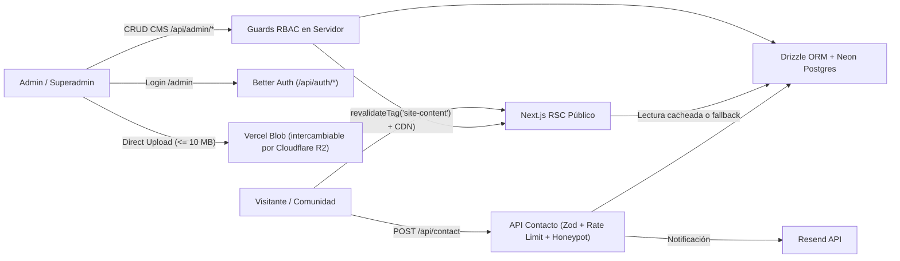

# Arquitectura del Sistema

## Visión General

La plataforma unifica el sitio institucional público y el panel administrativo CMS en una sola aplicación **Next.js 16.4 (App Router)** desplegada en **Vercel**, optimizada para carga rápida en territorios con conectividad limitada y operación administrativa segura con dos roles.

## Decisiones Arquitectónicas Clave

1. **Next.js 16 + Panel Propio + Better Auth + Drizzle (vs. CMS externos):**
   - Evita límites de roles gratuitos de SaaS externos (p. ej. falta de RBAC granular en planes gratis) y elimina los _cold starts_ y tamaño de paquete pesado (`~250 MB` en Vercel Hobby) de un CMS monolítico embebido.
   - Todo el flujo público y administrativo comparte contratos **Zod 4** y tipado estricto TypeScript.
2. **Resiliencia con ISR y Respaldo Estático (`src/lib/content/queries.ts`):**
   - Las rutas `/` y `/proyectos` consultan Neon a través de `unstable_cache` (`tag: 'site-content'`, `revalidate: 300`).
   - Cada mutación exitosa desde `/api/admin/*` ejecuta `revalidateTag('site-content', 'max')` y `revalidatePath`, reflejando cambios de inmediato sin redesplegar.
   - Si `DATABASE_URL` no existe (CI, pruebas E2E o clonado inicial), el sistema usa automáticamente `src/data/default-content.ts` con el contenido migrado de Wix.
3. **Almacenamiento Desacoplado para Evitar el Límite `4.5 MB` de Vercel (`src/lib/storage/`):**
   - Las funciones serverless de Vercel rechazan cuerpos `> 4.5 MB`. Como el activo hero original pesa `6.18 MB`, todas las subidas ocurren directamente desde el navegador hacia Vercel Blob mediante tokens firmados en `/api/admin/media/upload`.
   - El módulo `src/lib/storage/index.ts` abstrae `STORAGE_PROVIDER` (`vercel-blob` | `r2`) para migrar a **Cloudflare R2** sin reescribir componentes de UI.
4. **Contacto Híbrido (BD + Resend):**
   - Sustituye el envío frágil basado solo en correo electrónico por persistencia garantizada en `contact_messages` más notificación vía Resend, manteniendo enlaces `mailto:` y `tel:` visibles como canal alternativo.
