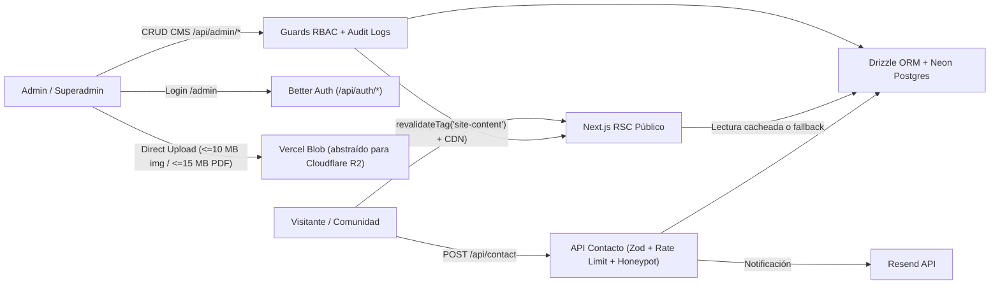

# Arquitectura del Sistema

## Visión General

La plataforma unifica el sitio institucional público y el panel administrativo CMS modular en una sola aplicación **Next.js 16.4 (App Router)** desplegada en **Vercel**, diseñada bajo el sistema visual **60-30-10** derivado del logotipo oficial (`#FCFBF8`, `#3B2816`, `#6E4713`, `#C68E28`), optimizada para conectividad limitada en territorio y operación segura con dos roles RBAC (`superadmin` | `admin`).

## Decisiones Arquitectónicas Clave

1. **Next.js 16 + Panel Modular en 7 Módulos + Better Auth + Drizzle (vs. CMS externos):**
   - Evita límites de roles gratuitos de SaaS externos y elimina el peso de bundle y _cold starts_ de un CMS monolítico embebido.
   - El panel separa edición de **Secciones**, **Áreas de Acción**, **Proyectos**, **Biblioteca Multimedia**, **Bandeja Semaforizada de Mensajes**, **Configuración Global** y **Usuarios/Auditoría** con selects accesibles (`ResponsiveSelect`) para pantallas compactas (`360px`).
   - Todo el flujo público y administrativo comparte contratos **Zod 4** y tipado estricto TypeScript.

2. **Resiliencia con ISR y Respaldo Estático (`src/lib/content/queries.ts`):**
   - Las rutas `/` y `/proyectos` consultan Neon a través de `unstable_cache` (`tag: 'site-content'`, `revalidate: 300`, clave `public-site-content-v2`).
   - Cada mutación exitosa desde `/api/admin/*` ejecuta `revalidateTag('site-content', 'max')` y `revalidatePath`, reflejando cambios de inmediato sin redesplegar.
   - Si `DATABASE_URL` no existe (CI, pruebas E2E o clonado inicial), el sistema usa automáticamente [`src/data/default-content.ts`](../../src/data/default-content.ts) con los textos, áreas, proyectos y activos base.

3. **Almacenamiento Desacoplado y Rendimiento CDN (`src/lib/storage/` + `src/lib/media/embeds.ts`):**
   - Las funciones serverless de Vercel rechazan cuerpos `> 4.5 MB`. Como el hero panorámico (`4500×1700`) y cartillas institucionales pueden superar ese tamaño, las subidas ocurren directamente desde el navegador hacia Vercel Blob vía `/api/admin/media/upload` (`<= 10 MB` imágenes, `<= 15 MB` PDFs), y `pnpm run media:migrate-blob` / `POST /api/admin/media/sync` sincronizan activos en Neon.
   - `isNextOptimizableImage(url)` restringe el proxy `/_next/image` únicamente a rutas locales `/...`, cargando activos en **Vercel Blob**, **Cloudflare R2** o miniaturas YouTube directo desde sus CDN para evitar timeouts de proxy en imágenes multi-megabyte.
   - El módulo `src/lib/storage/index.ts` abstrae `STORAGE_PROVIDER` (`vercel-blob` | `r2`) para migrar a **Cloudflare R2** sin reescribir la UI.

4. **Multimedia Híbrida con Privacidad (`src/components/media/`):**
   - `parseVideoEmbed` convierte enlaces HTTPS de YouTube y Vimeo a sus variantes sin cookies de rastreo (`youtube-nocookie.com/embed/...` y `player.vimeo.com/video/...?dnt=1`), cargando los iframes bajo demanda mediante fachada ligera (`VideoEmbedCard`).
   - Las galerías mixtas combinan fotografías con lightbox y videos en `MixedMediaShowcase`, y los documentos adjuntos se muestran con vista previa y descarga en `DocumentDownloadList`.

5. **Orígenes Dinámicos Preview/Producción y Contacto Híbrido:**
   - `src/lib/auth/origins.ts` resuelve automáticamente URLs dinámicas de Vercel Preview (`VERCEL_BRANCH_URL`, `VERCEL_URL`) y producción (`NEXT_PUBLIC_APP_URL`, `VERCEL_PROJECT_PRODUCTION_URL`) tanto para Better Auth (`resolveAuthBaseUrl`, `resolveTrustedOrigins`) como para metadatos SEO/sitemap (`resolvePublicSiteUrl`).
   - El formulario `/#contacto` persiste siempre en `contact_messages` cuando hay BD y notifica vía Resend, manteniendo enlaces `mailto:` y `tel:+57` visibles como canal directo.
